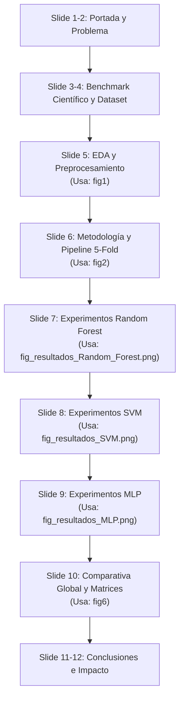

# GUÍA MAESTRA DE TRASPASO Y CONTINUIDAD: PROYECTO 3 DE MACHINE LEARNING
## *Predicción de Alto Rendimiento Académico (GPA) a partir de Hábitos de Sueño (Fitbit)*

> **Curso:** Introducción a la Inteligencia Artificial  
> **Institución:** Pontificia Universidad Javeriana — Departamento de Ingeniería de Sistemas  
> **Docente:** Enrique González, PhD  
> **Proyecto:** Proyecto 3 — Modelos de Clasificación Supervisada y Diseño Experimental (Fases 2, 3 y 4)  
> **Estado del Proyecto:** Código 100% implementado, datos limpios, 27 experimentos ejecutados, resultados tabulados y 6 figuras gráficas de alta resolución generadas.  
> **Objetivo de este documento:** Proveer al compañero de equipo toda la información contextual, técnica, metodológica, experimental y operativa para retomar el proyecto sin fricciones y estructurar la presentación oral final (Fase 4).

---

## TABLA DE CONTENIDO
1. [Resumen Ejecutivo del Proyecto](#1-resumen-ejecutivo-del-proyecto)
2. [Estructura del Repositorio y Archivos](#2-estructura-del-repositorio-y-archivos)
3. [Contexto Teórico y Benchmark Científico](#3-contexto-teórico-y-benchmark-científico)
4. [Dataset y Preprocesamiento de Datos](#4-dataset-y-preprocesamiento-de-datos)
5. [Metodología y Diseño Experimental (Fase 3)](#5-metodología-y-diseño-experimental-fase-3)
6. [Resultados Obtenidos y Tablas Detalladas](#6-resultados-obtenidos-y-tablas-detalladas)
7. [Análisis Crítico del Comportamiento de Modelos](#7-análisis-crítico-del-comportamiento-de-modelos)
8. [Cómo Ejecutar el Código y el Notebook](#8-cómo-ejecutar-el-código-y-el-notebook)
9. [Guía para la Presentación Final (Fase 4 - Diapositivas)](#9-guía-para-la-presentación-final-fase-4---diapositivas)
10. [Checklist de Entregables Pendientes](#10-checklist-de-entregables-pendientes)

---

## 1. RESUMEN EJECUTIVO DEL PROYECTO

### ¿Qué problema aborda este proyecto?
Se analiza la relación causal y predictiva entre los **patrones biométricos objetivos de sueño** (registrados mediante dispositivos wearables Fitbit) y el **rendimiento académico universitario** medido a través del promedio acumulado del semestre (`term_gpa`).

El problema se formula como una **clasificación binaria supervisada**:
$$\text{Clase 1: Alto Rendimiento} \quad (\text{term\_gpa} \ge 3.5)$$
$$\text{Clase 0: Rendimiento Estándar/Bajo} \quad (\text{term\_gpa} < 3.5)$$

### ¿Qué se ha implementado?
1. **Limpieza rigurosa de datos:** Tratamiento de valores faltantes camuflados como espacios en blanco, corrección de errores de dominio en variables demográficas y corrección de asimetría estadística en variables de sueño mediante transformación logarítmica.
2. **Evaluación de tres técnicas de Machine Learning:**
   - **Random Forest (RF):** Ensamblaje de árboles de decisión por Bagging.
   - **Support Vector Machines (SVM):** Clasificador de vector de soporte con margen suave y kernels.
   - **Perceptrón Multicapa (MLP):** Red neuronal feedforward totalmente conectada.
3. **Diseño experimental 3×3 = 9 casos por modelo (27 casos totales):**
   - 3 hiperparámetros por técnica en 3 niveles (Bajo, Defecto/Base, Alto).
   - Validación cruzada estratificada de 5 particiones (`StratifiedKFold(n_splits=5)`).
   - Preprocesamiento encapsulado dentro de `Pipeline` de Scikit-Learn para garantizar **cero fuga de información (cero data leakage)**.
4. **Resultados concluyentes:**
   - **Modelo Ganador:** **Random Forest (Caso C3: 500 estimadores)** obtuvo el mejor rendimiento general:
     - **F1-Score Macro:** $0.7446 \pm 0.0371$
     - **Accuracy:** $75.24\%$
     - **ROC-AUC:** $0.8174$
     - **Matriz de Confusión Acumulada:** $184$ Verdaderos Negativos, $83$ Falsos Positivos, $74$ Falsos Negativos y $293$ Verdaderos Positivos.

---

## 2. ESTRUCTURA DEL REPOSITORIO Y ARCHIVOS

El proyecto se encuentra ubicado en la ruta local:
`c:\Users\nicoc\Downloads\INTRO A IA\Proyecto_3_ML_Sleep_GPA\`

```text
Proyecto_3_ML_Sleep_GPA/
│
├── data/
│   ├── cmu-sleep.csv                 <- Dataset original en crudo (634 filas, 15 columnas)
│   └── cmu_sleep_limpio.csv          <- Dataset limpio con variable objetivo y features tratadas
│
├── resultados/
│   ├── tabla_pruebas_preliminares.csv            <- Barrido preliminar de hiperparámetros
│   ├── tabla_experimento_Random_Forest.csv       <- Diseño experimental 9 casos RF
│   ├── tabla_experimento_SVM.csv                 <- Diseño experimental 9 casos SVM
│   ├── tabla_experimento_MLP.csv                 <- Diseño experimental 9 casos MLP
│   ├── tabla_comparativa_mejores_modelos.csv     <- Cuadro comparativo final de los 3 mejores
│   │
│   └── figuras/
│       ├── fig1_eda_distribuciones_y_correlacion.png  <- Análisis exploratorio (4 subgráficos)
│       ├── fig2_diseno_experimental_esquema.png       <- Diagrama de arquitectura del experimento
│       ├── fig_resultados_Random_Forest.png           <- Gráficos de barra con barras de error RF
│       ├── fig_resultados_SVM.png                     <- Gráficos de barra con barras de error SVM
│       ├── fig_resultados_MLP.png                     <- Gráficos de barra con barras de error MLP
│       └── fig6_comparacion_y_matrices_confusion.png  <- Comparativa global + 3 matrices confusión
│
├── proyecto3_sueno_gpa.py            <- Script maestro autónomo en Python (596 líneas)
├── Proyecto_3_Sueno_vs_GPA.ipynb     <- Cuaderno interactivo Jupyter documentado celda a celda
└── GUIA_MAESTRA_PROYECTO_3_SUENO_GPA.md <- Esta guía completa de traspaso
```

---

## 3. CONTEXTO TEÓRICO Y BENCHMARK CIENTÍFICO

### El Estudio de Referencia (PNAS 2023)
- **Artículo:** Creswell, J. D., Tumminia, M. J., Price, S., et al. (2023). *"Nightly sleep duration predicts grade point average in the first year of college"*. *Proceedings of the National Academy of Sciences (PNAS)*, 120(8), e2209123120.
- **Repositorio CMU:** [Carnegie Mellon University Data Repository](https://cmustatistics.github.io/data-repository/psychology/cmu-sleep.html).
- **Kaggle:** [CMU Sleep Dataset](https://www.kaggle.com/datasets/mexwell/cmu-sleep).

### Hallazgo Central del Estudio Original
En el estudio de Creswell et al., los autores encontraron mediante modelos de regresión lineal múltiple que **cada hora adicional de sueño nocturno promedio a lo largo del semestre se asociaba con un incremento de 0.07 puntos en el GPA final**, incluso controlando por el promedio académico previo de secundaria/colegio y la carga académica de créditos.

### ¿Cuál es nuestro aporte en este Proyecto de Inteligencia Artificial?
Mientras el paper original se limitó a modelos econométricos y lineales tradicionales, nuestro proyecto:
1. **Reformula el problema como Clasificación:** Identificar tempranamente a aquellos estudiantes en riesgo académico versus aquellos con alta probabilidad de alcanzar honores ($GPA \ge 3.5$).
2. **Evalúa no-linealidades y patrones complejos:** Modela interacciones multidimensionales mediante métodos de frontera no lineal (SVM con Kernel RBF, ensambles basados en árboles con Random Forest y redes neuronales densas MLP).
3. **Controla el sesgo y la fuga de datos:** Implementa un protocolo riguroso con validación cruzada estratificada en 5 folds para simular cómo generalizaría el modelo en cohortes futuras de estudiantes.

---

## 4. DATASET Y PREPROCESAMIENTO DE DATOS

### 4.1. Características del Conjunto de Datos
- **Muestra:** $N = 634$ estudiantes de primer año universitario distribuidos en 5 cohortes académicas.
- **Instrumentación:** Relojes biométricos Fitbit Flex y Fitbit Charge HR utilizados durante todo el semestre académico.

### 4.2. Diccionario de Variables Utilizadas
| Variable | Tipo | Unidad | Descripción e Interpretación |
| :--- | :--- | :--- | :--- |
| `TotalSleepTime` | Numérica | Minutos | Promedio diario de minutos dormidos durante la noche (~421 min = 7.02 horas). |
| `bedtime_mssd` | Numérica | $\text{min}^2$ | Media cuadrática de diferencias sucesivas de la hora de acostarse (mide irregularidad circadiana). |
| `log_bedtime_mssd` | Numérica | Adimensional | $\ln(1 + \text{bedtime\_mssd})$: transformación logarítmica para corregir asimetría estadística. |
| `midpoint_sleep` | Numérica | Minutos post-medianoche | Hora media del sueño (p. ej., 240 = 4:00 AM). Indica cronotipo matutino vs vespertino. |
| `daytime_sleep` | Numérica | Minutos | Promedio diario de tiempo en siestas diurnas. |
| `frac_nights_with_data` | Numérica | Proporción [0, 1] | Porcentaje de noches en las que el estudiante usó el reloj de forma válida. |
| `cum_gpa` | Numérica | Escala 0.0 a 4.0 | GPA acumulado del estudiante antes del semestre en curso. |
| `Zterm_units_ZofZ` | Numérica | Z-Score | Carga académica estandarizada de créditos inscritos en el período. |
| `demo_race` | Categórica | Código [1-5] | Etnia/Raza autorreportada por el estudiante. |
| `demo_gender` | Binaria | {1, 2} | Género del estudiante (1 = Masculino, 2 = Femenino). |
| `demo_firstgen` | Binaria | {0, 1} | Estudiante universitario de primera generación (0 = No, 1 = Sí). |
| **`Alto_Rendimiento`** | **Binaria (Target)** | **{0, 1}** | **1 si `term_gpa >= 3.5`, 0 en caso contrario. Variable a predecir.** |

### 4.3. Reglas de Limpieza de Dominio Aplicadas
1. **Espacios en blanco como NaNs:** El archivo CSV crudo contenía celdas con caracteres de espacio (`' '`), lo que hacía que pandas infiriera columnas como `object`/texto. Se aplicó:
   ```python
   df = df.replace(r'^\s*$', np.nan, regex=True)
   ```
2. **Corrección de Dominio en `demo_firstgen`:** El diccionario formal define `demo_firstgen` estrictamente como binario $\{0, 1\}$. En el archivo crudo existían registros codificados con valor `2` (error de digitación en la encuesta). Esos valores se convirtieron a `np.nan` para evitar distorsiones.
3. **Tratamiento de Asimetría en `bedtime_mssd`:**
   - La variabilidad de acostarse tenía un coeficiente de asimetría (*skewness*) de **8.24** (presencia de colas pesadas por estudiantes con horarios erráticos de sueño).
   - Se aplicó la transformación $\text{log\_bedtime\_mssd} = \log_e(1 + \text{bedtime\_mssd})$.
   - El *skewness* resultante cayó a **1.15**, estabilizando la varianza y evitando distorsiones en los hiperplanos de SVM y en la convergencia de backpropagation en MLP.
4. **Balance de Clases de la Variable Objetivo:**
   - Clase 1 (`Alto_Rendimiento = 1`): $367$ observaciones ($57.89\%$).
   - Clase 0 (`Alto_Rendimiento = 0`): $267$ observaciones ($42.11\%$).
   - *Conclusión:* El dataset presenta un balance moderado y sano (~58/42), sin riesgo de colapso de clase trivial, permitiendo una evaluación sólida mediante F1-Macro y ROC-AUC.

---

## 5. METODOLOGÍA Y DISEÑO EXPERIMENTAL (FASE 3)

### 5.1. Protocolo Anti-Data Leakage
Para evitar el error común de fuga de información (donde la media y desviación del test set contaminan el entrenamiento), se implementó un `Pipeline` de Scikit-Learn que ejecuta de forma estrictamente aislada dentro de cada fold:
1. **Imputación:** `SimpleImputer(strategy='median')` entrenado **únicamente** con el fold de entrenamiento.
2. **Estandarización:** `StandardScaler()` ajustado **únicamente** sobre los datos de entrenamiento del fold y aplicado sobre el fold de validación.
3. **Clasificador:** Entrenado con los datos escalados del fold.

### 5.2. Esquema de Validación
- **Estrategia:** `StratifiedKFold(n_splits=5, shuffle=True, random_state=42)`.
- **Métrica Primaria (Variable Dependiente):** **F1-Score Macro** (media no ponderada de los F1-Scores de cada clase). Es la métrica obligatoria para evaluar equidad entre falsos positivos y falsos negativos.
- **Métricas Secundarias:** Accuracy, Precision Macro, Recall Macro, ROC-AUC y Desviación Estándar ($\sigma$).

### 5.3. Definición de Variables Independientes (Hiperparámetros Evaluados)
Cada modelo fue evaluado bajo un diseño $3 \times 3$ (3 hiperparámetros independientes en 3 niveles cada uno = 9 casos por modelo, 27 casos en total):

#### A. Random Forest (RF)
| Caso | Hiperparámetro Modificado | Nivel | Valor Evaluado | Justificación Teórica |
| :---: | :--- | :---: | :---: | :--- |
| **C1** | `n_estimators` (Cantidad de árboles) | Bajo | 5 | Evalúa subensamblaje con alta varianza individual. |
| **C2** | `n_estimators` | Defecto | 100 | Valor estándar de la literatura. |
| **C3** | `n_estimators` | Alto | 500 | Evalúa asíntota de convergencia del error de ensamble. |
| **C4** | `max_depth` (Profundidad máxima) | Bajo | 1 | *Decision Stumps*: evalúa sesgo extremo (subajuste). |
| **C5** | `max_depth` | Defecto | 10 | Controla la complejidad del árbol sin sobreajustar. |
| **C6** | `max_depth` | Alto | 30 | Árboles profundos con riesgo potencial de sobreajuste. |
| **C7** | `min_samples_leaf` (Muestras mínimas hoja) | Bajo | 1 | Permite hojas puras (mayor memorización). |
| **C8** | `min_samples_leaf` | Defecto | 5 | Regularización suave para mitigar ruido muestral. |
| **C9** | `min_samples_leaf` | Alto | 80 | Regularización severa; obliga a hojas muy pobladas. |

#### B. Support Vector Machines (SVM)
| Caso | Hiperparámetro Modificado | Nivel | Valor Evaluado | Justificación Teórica |
| :---: | :--- | :---: | :---: | :--- |
| **C1** | $C$ (Penalización margen suave) | Bajo | 0.01 | Margen extremadamente amplio; tolera gran cantidad de errores. |
| **C2** | $C$ | Defecto | 1.0 | Balance canónico entre margen y penalización de holguras. |
| **C3** | $C$ | Alto | 100.0 | Margen muy estricto; penaliza fuertemente violaciones (sobreajuste). |
| **C4** | $\gamma$ (Inverso radio influencia RBF) | Bajo | 0.001 | Campana gaussiana muy amplia; subajusta la frontera. |
| **C5** | $\gamma$ | Defecto | `'scale'` ($1 / (n \cdot \sigma^2)$) | Escalamiento automático heurístico óptimo. |
| **C6** | $\gamma$ | Alto | 2.0 | Campanas gaussianas puntiagudas; memoriza puntos soporte. |
| **C7** | $\text{Kernel}$ (Función de mapeo) | Bajo (Lineal) | `'linear'` | Frontera hiperplana directa; evalúa separabilidad lineal. |
| **C8** | $\text{Kernel}$ | Defecto (RBF) | `'rbf'` | Mapeo a espacio dimensional infinito con función de base radial. |
| **C9** | $\text{Kernel}$ | Alto (Poli-3) | `'poly'` ($d=3$) | Frontera polinomial cúbica; evalúa interacciones de tercer orden. |

#### C. Red Neuronal Perceptrón Multicapa (MLP)
| Caso | Hiperparámetro Modificado | Nivel | Valor Evaluado | Justificación Teórica |
| :---: | :--- | :---: | :---: | :--- |
| **C1** | `hidden_layer_sizes` (Arquitectura) | Bajo | (3,) | Red minimalista con subcapacidad de representación. |
| **C2** | `hidden_layer_sizes` | Defecto | (100,) | 1 capa densa de 100 neuronas con activación ReLU. |
| **C3** | `hidden_layer_sizes` | Alto | (300, 150) | Red profunda de 2 capas; evalúa riesgo de sobreparametrización. |
| **C4** | `learning_rate_init` (Tasa aprendizaje) | Bajo | 0.0001 | Pasos mínimos en optimizador Adam; riesgo de estancamiento. |
| **C5** | `learning_rate_init` | Defecto | 0.001 | Tasa de aprendizaje óptima por defecto para Adam. |
| **C6** | `learning_rate_init` | Alto | 0.5 | Pasos gigantescos; riesgo de oscilación y no convergencia. |
| **C7** | `max_iter` (Épocas máximas) | Bajo | 20 | Corte prematuro; evalúa subconvergencia deliberada. |
| **C8** | `max_iter` | Defecto | 200 | Límite suficiente para convergencia con tolerancia estándar. |
| **C9** | `max_iter` | Alto | 1000 | Entrenamiento prolongado para comprobar estabilidad asintótica. |

---

## 6. RESULTADOS OBTENIDOS Y TABLAS DETALLADAS

### 6.1. Cuadro Comparativo de los Mejores Modelos por Técnica
Esta tabla resume el mejor caso encontrado para cada una de las tres familias de algoritmos:

| Técnica | Mejor Caso | Hiperparámetro Clave | F1-Macro CV | Desv. Est. ($\sigma$) | Accuracy | Precision Macro | Recall Macro | ROC-AUC | Matriz Confusión Acumulada (TN, FP, FN, TP) |
| :--- | :---: | :--- | :---: | :---: | :---: | :---: | :---: | :---: | :---: |
| **Random Forest** | **C3** | **`n_estimators=500`** | **0.7446** | **0.0371** | **75.24%** | **0.7462** | **0.7438** | **0.8174** | **TN=184, FP=83, FN=74, TP=293** |
| **MLP** | C2 | `hidden_layer_sizes=(100,)` | 0.7151 | 0.0373 | 72.40% | 0.7168 | 0.7146 | 0.8007 | TN=175, FP=92, FN=83, TP=284 |
| **SVM** | C2 | $C=1.0$ (Kernel RBF) | 0.7127 | 0.0451 | 72.56% | 0.7199 | 0.7104 | 0.7946 | TN=164, FP=103, FN=71, TP=296 |

> **Interpretación de la Matriz de Confusión del Ganador (Random Forest C3):**
> De los 634 estudiantes evaluados en los 5 folds cruzados:
> - **293 estudiantes con alto GPA** fueron detectados correctamente como tales (Recall de la clase positiva: $293 / (293 + 74) = 79.84\%$).
> - **184 estudiantes con GPA menor a 3.5** fueron identificados correctamente (Especificidad: $184 / (184 + 83) = 68.91\%$).
> - Solamente 74 casos de alto rendimiento fueron omitidos por el clasificador.

---

### 6.2. Tabla de Resultados Completos: Random Forest (9 Casos)
| Caso | Hiperparámetro | Nivel | Valor | F1-Macro | F1-Std | Accuracy | Precision Macro | Recall Macro | ROC-AUC |
| :---: | :--- | :---: | :---: | :---: | :---: | :---: | :---: | :---: | :---: |
| C1 | `n_estimators` | Bajo | 5 | 0.7078 | 0.0422 | 0.7161 | 0.7086 | 0.7074 | 0.7859 |
| C2 | `n_estimators` | Defecto | 100 | 0.7414 | 0.0417 | 0.7492 | 0.7431 | 0.7404 | 0.8184 |
| **C3** | **`n_estimators`** | **Alto** | **500** | **0.7446** | **0.0371** | **0.7523** | **0.7462** | **0.7436** | **0.8174** |
| C4 | `max_depth` | Bajo | 1 | 0.6109 | 0.0244 | 0.6672 | 0.6887 | 0.6228 | 0.7997 |
| C5 | `max_depth` | Defecto | 10 | 0.7414 | 0.0417 | 0.7492 | 0.7431 | 0.7404 | 0.8184 |
| C6 | `max_depth` | Alto | 30 | 0.7429 | 0.0386 | 0.7508 | 0.7446 | 0.7418 | 0.8169 |
| C7 | `min_samples_leaf` | Bajo | 1 | 0.7262 | 0.0374 | 0.7350 | 0.7282 | 0.7251 | 0.8019 |
| C8 | `min_samples_leaf` | Defecto | 5 | 0.7414 | 0.0417 | 0.7492 | 0.7431 | 0.7404 | 0.8184 |
| C9 | `min_samples_leaf` | Alto | 80 | 0.6939 | 0.0311 | 0.7161 | 0.7177 | 0.6918 | 0.7903 |

---

### 6.3. Tabla de Resultados Completos: Support Vector Machines (9 Casos)
| Caso | Hiperparámetro | Nivel | Valor | F1-Macro | F1-Std | Accuracy | Precision Macro | Recall Macro | ROC-AUC |
| :---: | :--- | :---: | :---: | :---: | :---: | :---: | :---: | :---: | :---: |
| C1 | $C$ | Bajo | 0.01 | 0.3666 | 0.0014 | 0.5789 | 0.2894 | 0.5000 | 0.7974 |
| **C2** | **$C$** | **Defecto** | **1.0** | **0.7127** | **0.0451** | **0.7256** | **0.7211** | **0.7105** | **0.7946** |
| C3 | $C$ | Alto | 100.0 | 0.6527 | 0.0190 | 0.6688 | 0.6610 | 0.6518 | 0.6983 |
| C4 | $\gamma$ | Bajo | 0.001 | 0.4706 | 0.0324 | 0.6183 | 0.7487 | 0.5489 | 0.8128 |
| C5 | $\gamma$ | Defecto | `'scale'` | 0.7127 | 0.0451 | 0.7256 | 0.7211 | 0.7105 | 0.7946 |
| C6 | $\gamma$ | Alto | 2.0 | 0.4770 | 0.0419 | 0.6072 | 0.6478 | 0.5425 | 0.7243 |
| C7 | $\text{Kernel}$ | Bajo | `'linear'` | 0.7093 | 0.0448 | 0.7223 | 0.7164 | 0.7070 | 0.8120 |
| C8 | $\text{Kernel}$ | Defecto | `'rbf'` | 0.7127 | 0.0451 | 0.7256 | 0.7211 | 0.7105 | 0.7946 |
| C9 | $\text{Kernel}$ | Alto | `'poly'` | 0.6643 | 0.0445 | 0.7019 | 0.7165 | 0.6665 | 0.7873 |

---

### 6.4. Tabla de Resultados Completos: Perceptrón Multicapa (MLP) (9 Casos)
| Caso | Hiperparámetro | Nivel | Valor | F1-Macro | F1-Std | Accuracy | Precision Macro | Recall Macro | ROC-AUC |
| :---: | :--- | :---: | :---: | :---: | :---: | :---: | :---: | :---: | :---: |
| C1 | `hidden_layer_sizes` | Bajo | (3,) | 0.6387 | 0.0436 | 0.6593 | 0.6513 | 0.6381 | 0.7340 |
| **C2** | **`hidden_layer_sizes`** | **Defecto** | **(100,)** | **0.7151** | **0.0373** | **0.7240** | **0.7177** | **0.7146** | **0.8007** |
| C3 | `hidden_layer_sizes` | Alto | (300, 150) | 0.6839 | 0.0199 | 0.6956 | 0.6893 | 0.6832 | 0.7674 |
| C4 | `learning_rate_init` | Bajo | 0.0001 | 0.7041 | 0.0343 | 0.7287 | 0.7354 | 0.7016 | 0.8087 |
| C5 | `learning_rate_init` | Defecto | 0.001 | 0.7151 | 0.0373 | 0.7240 | 0.7177 | 0.7146 | 0.8007 |
| C6 | `learning_rate_init` | Alto | 0.5 | 0.7005 | 0.0224 | 0.7114 | 0.7098 | 0.7006 | 0.7790 |
| C7 | `max_iter` | Bajo | 20 | 0.7095 | 0.0337 | 0.7318 | 0.7362 | 0.7064 | 0.8077 |
| C8 | `max_iter` | Defecto | 200 | 0.7151 | 0.0373 | 0.7240 | 0.7177 | 0.7146 | 0.8007 |
| C9 | `max_iter` | Alto | 1000 | 0.6858 | 0.0371 | 0.6988 | 0.6925 | 0.6843 | 0.7522 |

---

## 7. ANÁLISIS CRÍTICO DEL COMPORTAMIENTO DE MODELOS

Esta sección es crucial para la exposición oral y la argumentación frente al profesor Enrique González.

### 1. ¿Por qué Random Forest superó a SVM y MLP?
1. **Tratamiento natural de variables heterogéneas:** El dataset contiene variables continuas (minutos de sueño, GPA previo), ordinales y discretas/categóricas (`demo_race`, `demo_gender`). Los árboles de decisión dividen el espacio de estados mediante hiperplanos ortogonales a los ejes, siendo invariantes a transformaciones monótonas y menos sensibles al escalado relativo entre variables.
2. **Efecto estabilizador del Bagging con 500 árboles:** Al promediar 500 árboles no correlacionados, la varianza del modelo se reduce sustancialmente ($\sigma = 0.0371$), amortiguando el ruido inherente a los sensores de Fitbit (noches atípicas, desincronización, fiestas de fin de semana).
3. **Resistencia al sobreajuste:** A diferencia de una red neuronal profunda, aumentar `n_estimators` en Random Forest no induce sobreajuste; por el teorema de la ley de los grandes números, el error de generalización converge a un límite asintótico.

### 2. Patologías Identificadas en Support Vector Machines (SVM)
- **El colapso de $C=0.01$ (Caso C1):** Cuando la constante de penalización es ínfima, el costo de violar el margen es despreciable. El optimizador maximiza el ancho del margen clasificando a **todos los estudiantes en la clase mayoritaria (Clase 1)**. Como consecuencia:
  - $\text{Accuracy} = 367 / 634 = 57.89\%$ (exactamente la prevalencia de la clase mayoritaria).
  - $\text{Recall}(\text{Clase 0}) = 0$, provocando un colapso del F1-Score Macro a **0.3666**.
  - Este resultado es un ejemplo de libro de subajuste patológico por regularización desmedida.
- **La trampa de $\gamma=2.0$ y $C=100$:** Con un gamma muy alto, cada punto de entrenamiento se convierte en su propia isla de decisión en el espacio RBF; la frontera se vuelve espinosa, la generalización se desploma a F1=0.4770 y el modelo memoriza el ruido.

### 3. Comportamiento y Sobredimensionamiento en Redes Neuronales (MLP)
- **Sobredimensionamiento en muestras pequeñas ($N=634$):** Una arquitectura de 2 capas con $(300, 150)$ neuronas contiene más de $48,000$ pesos entrenables. Con solo $634$ observaciones, la red sufre de sobreparametrización y memorización, rindiendo un F1-Macro de $0.6839$, inferior a una simple arquitectura de una capa con 100 neuronas ($0.7151$).
- **Estabilidad de Adam:** La tasa de aprendizaje por defecto $\eta = 0.001$ demostró ser el punto óptimo de convergencia; valores agresivos como $\eta = 0.5$ indujeron oscilaciones en los gradientes, degradando el F1 a $0.7005$.

---

## 8. CÓMO EJECUTAR EL CÓDIGO Y EL NOTEBOOK

### 8.1. Requisitos del Entorno Python
El código utiliza las librerías científicas estándar de Python 3.10+:
```bash
pip install numpy pandas scikit-learn matplotlib seaborn
```

### 8.2. Ejecución del Script Automatizado
Para reproducir todos los experimentos, recalcular las tablas y regenerar todas las figuras gráficas en alta resolución:
```bash
cd "c:\Users\nicoc\Downloads\INTRO A IA\Proyecto_3_ML_Sleep_GPA"
python proyecto3_sueno_gpa.py
```
*Tiempo estimado de ejecución:* Aproximadamente 45 a 60 segundos (ejecuta 27 validaciones cruzadas x 5 folds = 135 modelos ajustados).

### 8.3. Exploración Interactiva en Jupyter Notebook
Para presentar o modificar interactivamente las visualizaciones:
```bash
jupyter notebook Proyecto_3_Sueno_vs_GPA.ipynb
```
El notebook contiene explicaciones en Markdown intercaladas antes de cada celda de código, ideal para mostrar la ejecución en vivo si el profesor lo solicita.

---

## 9. GUÍA PARA LA PRESENTACIÓN FINAL (FASE 4 - DIAPOSITIVAS)

A continuación se presenta la propuesta exacta de estructura para las diapositivas de la presentación oral (12 minutos reglamentarios), vinculando cada una con la figura PNG ya generada en la carpeta `resultados/figuras/`.



### Mapeo Diapositiva por Diapositiva:

#### Diapositiva 1: Portada
- **Título:** Predicción de Alto Rendimiento Académico a partir de Datos Biométricos de Sueño (Fitbit).
- **Subtítulo:** Evaluación Comparativa de Random Forest, SVM y MLP bajo Diseño Experimental 3×3.
- **Integrantes:** Nombres completos del equipo.
- **Materia:** Introducción a la Inteligencia Artificial — Pontificia Universidad Javeriana.

#### Diapositiva 2: Planteamiento del Problema y Justificación
- **El reto:** ¿Es el sueño un predictor determinante del éxito académico o solo un reflejo correlacionado del esfuerzo?
- **Formulación:** Clasificación supervisada de estudiantes con alto rendimiento ($GPA \ge 3.5$) usando mediciones objetivas de wearables.
- **Importancia:** Permite a las universidades y consejerías académicas generar intervenciones preventivas de salud y tutoría antes de los exámenes finales.

#### Diapositiva 3: Contexto Científico y Dataset
- **Paper de Referencia:** Creswell et al. (PNAS 2023), Carnegie Mellon University ($N=634$).
- **Dispositivos:** Fitbit Flex y Charge HR midiendo duración nocturna, irregularidad de horario (`bedtime_mssd`) y cronotipo (`midpoint_sleep`).
- **Novedad del proyecto:** Pasar de regresión lineal simple a modelos no lineales de Inteligencia Artificial con validación cruzada.

#### Diapositiva 4: Preprocesamiento y Limpieza de Dominio
- **Espacios ocultos:** Detección y conversión de cadenas vacías `' '` a `NaN`.
- **Anomalías en demografía:** Corrección de la variable `demo_firstgen` eliminando el código espurio `2`.
- **Tratamiento de Asimetría Circadiana:** Transformación $\ln(1 + \text{bedtime\_mssd})$, reduciendo el *skewness* de $8.24$ a $1.15$.
- **Balance de Clases:** $57.9\%$ Clase 1 vs $42.1\%$ Clase 0 (distribución balanceada y clínicamente realista).

#### Diapositiva 5: Análisis Exploratorio de Datos (EDA)
- **Imagen a proyectar:** `resultados/figuras/fig1_eda_distribuciones_y_correlacion.png`
- **Puntos a explicar oralmente:**
  - El gráfico muestra que los estudiantes con $GPA \ge 3.5$ duermen en promedio **25 minutos más por noche** que aquellos con bajo rendimiento.
  - La irregularidad de la hora de dormir (`bedtime_mssd`) correlaciona negativamente con el GPA: acostarse a horas drásticamente variables perjudica el rendimiento incluso si se duerme la misma cantidad de horas.
  - La correlación entre $GPA$ previo y $GPA$ del semestre es alta, pero las variables biométricas de sueño aportan información residual ortogonal e independiente.

#### Diapositiva 6: Metodología y Diseño Experimental (Fase 3)
- **Imagen a proyectar:** `resultados/figuras/fig2_diseno_experimental_esquema.png`
- **Puntos a explicar oralmente:**
  - Diseño factorial $3 \times 3 = 9$ casos por técnica (27 experimentos totales).
  - Variable Dependiente: F1-Score Macro con Stratified 5-Fold CV.
  - Protocolo Anti-Leakage: Explicar cómo el `Pipeline` encapsula `SimpleImputer` y `StandardScaler` dentro de cada pliegue de validación.

#### Diapositiva 7: Resultados Random Forest
- **Imagen a proyectar:** `resultados/figuras/fig_resultados_Random_Forest.png`
- **Puntos a explicar oralmente:**
  - `n_estimators`: Crecer de 5 a 500 árboles eleva el F1-Macro de $0.7078$ a **$0.7446$** y contrae las barras de error ($\sigma = 0.0371$).
  - `max_depth`: Un árbol con profundidad 1 (*decision stump*) colapsa a F1=$0.6109$. A partir de profundidad 10 se estabiliza.
  - `min_samples_leaf`: Un valor excesivo (80) regulariza demasiado y degrada el desempeño a $0.6939$. El balance óptimo está en 5.

#### Diapositiva 8: Resultados Support Vector Machines (SVM)
- **Imagen a proyectar:** `resultados/figuras/fig_resultados_SVM.png`
- **Puntos a explicar oralmente:**
  - Caso crítico $C=0.01$: F1-Macro se desploma a $0.3666$ por margen excesivo (todos predichos como clase 1).
  - Efecto de $\gamma$: Valores extremos (0.001 y 2.0) degradan fuertemente el modelo; `'scale'` logra el balance ideal ($F1 = 0.7127$).
  - Kernels: El Kernel RBF supera tanto a la frontera lineal ($0.7093$) como a la polinomial ($0.6643$), confirmando no-linealidades suaves en los biométricos de sueño.

#### Diapositiva 9: Resultados Perceptrón Multicapa (MLP)
- **Imagen a proyectar:** `resultados/figuras/fig_resultados_MLP.png`
- **Puntos a explicar oralmente:**
  - Tamaño de red: La red moderada de 1 capa con 100 neuronas ($F1 = 0.7151$) supera a la red profunda $(300, 150)$ que sobreajusta ($F1 = 0.6839$) debido a la cantidad reducida de datos ($N=634$).
  - Tasa de aprendizaje: $\eta = 0.001$ converge óptimamente. Con $\eta = 0.5$ se producen rebotes en la superficie de error.
  - Iteraciones: 200 épocas son suficientes; extender a 1000 épocas no mejora el F1 e incrementa el costo computacional.

#### Diapositiva 10: Comparativa Global y Matrices de Confusión
- **Imagen a proyectar:** `resultados/figuras/fig6_comparacion_y_matrices_confusion.png`
- **Puntos a explicar oralmente:**
  - Comparar las métricas de los 3 modelos ganadores: RF ($0.7446$) vs MLP ($0.7151$) vs SVM ($0.7127$).
  - Analizar las matrices de confusión: Random Forest minimiza los falsos negativos (solo 74) alcanzando un Recall de casi $80\%$ para estudiantes destacados, al tiempo que preserva una alta especificidad en los estudiantes en riesgo.

#### Diapositivas 11 y 12: Conclusiones, Recomendaciones y Q&A
- **Conclusión de IA:** Random Forest demostró ser la técnica más robusta y generalizable para datos tabulares heterogéneos y biométricos portables con ruido.
- **Conclusión de Dominio:** Los hábitos de sueño no son un factor accesorio: la regularidad del horario de descanso y alcanzar más de 7 horas diarias son predictores estadísticamente significativos del desempeño académico universitario.
- **Recomendación para la Javeriana:** Incorporar alertas tempranas de sueño y bienestar en programas de acompañamiento estudiantil durante los primeros semestres universitarios.

---

## 10. CHECKLIST DE ENTREGABLES PENDIENTES (PARA EL COMPAÑERO)

| Tarea | Estado | Responsable | Instrucciones |
| :--- | :---: | :---: | :--- |
| **Limpieza de datos y dataset limpio** | **Listo** | Automatizado | Archivo `data/cmu_sleep_limpio.csv`. |
| **Código Python y Notebook** | **Listo** | Automatizado | `proyecto3_sueno_gpa.py` y `Proyecto_3_Sueno_vs_GPA.ipynb`. |
| **Diseño experimental 27 casos** | **Listo** | Automatizado | Tablas CSV generadas en carpeta `resultados/`. |
| **Figuras de alta resolución (300 DPI)** | **Listo** | Automatizado | 6 archivos PNG listos en `resultados/figuras/`. |
| **Montar diapositivas en PowerPoint o Canva** | **PENDIENTE** | **Compañero** | Importar las imágenes de `resultados/figuras/` siguiendo la estructura de la Sección 9. |
| **Grabar o ensayar video de exposición (12 min)** | **PENDIENTE** | **Equipo** | Ensayar distribución del tiempo (aprox. 1 min por diapositiva) según los puntos orales detallados. |
| **Revisar rúbrica de entrega del Prof. González** | **PENDIENTE** | **Compañero** | Verificar formato de entrega (link de video, archivo ZIP con código y presentación PDF/PPT). |

---
*Documento preparado y generado para el equipo de trabajo de Inteligencia Artificial - Pontificia Universidad Javeriana.*
